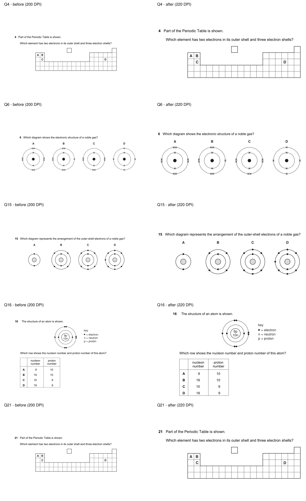

# Graphics-aware crop verification — 2026-11-15

Local implementation uses PyMuPDF only. No dependencies, migrations, authentication, grading, or production resources were changed.

## Behavior

- Collect nonempty vector drawing rectangles and raster image bounds; exclude page backgrounds and existing repeated header/footer bands.
- Expand question regions to a fixed point through graphics whose tops lie in the region. A graphic extending into the next question's text interval fails attribution conservatively.
- Union words and graphics, add 8 pt padding, and render at 220 DPI.
- Mark previews invalid when any retained graphic intersects a crop without full containment, or any channel in the top/bottom two pixel rows is not white. Crop regeneration also rejects these failures before replacing images. Import-all cannot bypass crop errors in the preview.
- Raster uploads are opened by PyMuPDF and normalized to PDF for existing private storage. PNG/JPG and image-only PDF use scan mode: 120 DPI grayscale analysis, dark threshold 200, noise tolerance 0.3% of row width, and at least 24 blank rows per split. Pages with under 5% blank rows become an invalid manual-crop region. Numbers are provisional; OCR and deskew are not used.
- Crop-cache identity is versioned, so re-uploading an old source creates new graphics-aware crops. Existing saved questions are not automatically recropped. Hashing original upload bytes preserves re-upload deduplication.

## Before / after

Before images were saved from the pre-change importer at 200 DPI. After images use 220 DPI and tighter horizontal bounds. Both sides are fitted into equal display panels, so apparent scale changes are expected. The original implementation already contained the main diagrams in these five fixtures; the comparison does not establish a previously missing drawing in those five examples. Synthetic cases establish the new boundary failure behavior.



| Question | Before | After |
| --- | --- | --- |
| Q4 | [PNG](q4-before.png) | [PNG](q4-after.png) |
| Q6 | [PNG](q6-before.png) | [PNG](q6-after.png) |
| Q15 | [PNG](q15-before.png) | [PNG](q15-after.png) |
| Q16 | [PNG](q16-before.png) | [PNG](q16-after.png) |
| Q21 | [PNG](q21-before.png) | [PNG](q21-after.png) |

The comparison image was visually inspected. The periodic tables, electron-shell drawings, Q16 table, labels, and question text appear intact. No claim of universally exact attribution is made.

## Attribution

Reference tests cover Q4, Q6, Q7, Q9, Q14, Q15, Q16, and Q21: every nonempty drawing box in its independently derived question interval must be contained; top/bottom two rows must be white; header/footer and section-heading text must be absent. Existing tests additionally check header/footer exclusion for every question.

Two reference drawings have no question owner. They are section-heading underlines, above the first question in each section, and remain outside the crops:

| Page | Rectangle in PDF points |
| --- | --- |
| 1 | (260.510, 68.763, 311.096, 70.233) |
| 7 | (264.517, 75.136, 314.608, 76.606) |

The synthetic fixture has a low Q1 rectangle at (100, 190, 250, 290), fully retained, and a deliberately ambiguous rectangle at (250, 450, 420, 565) crossing Q2/Q3. Both affected previews are invalid and explain the overlap/clipping. No unique owner is claimed for that rectangle.

The scan fixture, rendered to PNG and re-imported, splits **2 of 2** questions correctly. A deliberately noisy version yields **one invalid manual-crop region**, rather than invented question splits. These are controlled examples, not an accuracy estimate for arbitrary scanned papers. Large white gaps within a question can still over-segment it; review/merge controls remain necessary.

## Files changed by this workstream

- `backend/app/exams/pdf_import.py`: geometry, clipping guards, image normalization, and scan projection.
- `backend/app/exams/pdf_storage.py`: 220 DPI default and checked manual regeneration.
- `backend/app/exams/router.py`: scan routing, preview failures, versioned source reuse.
- `backend/app/exams/schemas.py`: scan-mode flag and DPI default.
- `backend/tests/test_pdf_graphics.py`: new geometry, pixel, attribution, raster, and noise tests.
- `backend/tests/test_pdf_import.py`: new tight-box and 220 DPI expectations.
- `backend/tests/test_exams.py`: actual scan pipeline, raster upload, failed preview, and regeneration tests.
- `backend/tests/fixtures/graphics_boundaries.pdf`: low and straddling vector drawings.
- `frontend/src/features/admin/adminApi.ts`, `components/PdfCropEditor.tsx`: matching DPI defaults.
- `frontend/src/features/admin/components/BulkParserPanel.tsx`: image selection, scan label, and crop-error handling.
- `frontend/src/types/adminExam.ts`: optional scan-mode response flag.
- `docs/agent-coordination.md`: ownership and handoff.
- `output/pdf/graphics-crops/`: evidence, crops, comparison, test output, and this report.

Concurrent changes to other frontend pages, layouts, authentication UI, and uploaded branding images belong to another workstream and were not reverted or claimed.

## Verification limitations

Browser-session discovery timed out. The authenticated importer, drag handles, and responsive UI at the required viewport widths have not been verified in a browser. No production deployment, live Neon test, or production mutation was performed. OCR/deskew and mixed searchable/scanned-page papers were not verified. Scan mode cannot semantically distinguish header/footer pixels or question numbers without OCR; scan previews require review. Existing text-layer header/footer/watermark exclusion was retained.

## Executed checks

```text
Full backend: 302 passed in 356.98s (0:05:56)
Focused final backend rerun: 109 passed in 51.22s
ruff check app tests alembic: All checks passed!
alembic heads: 0006_submission_reason (head)
alembic history: one linear chain, 0001 through 0006
npm ci: added 410 packages, audited 417 packages; exit 0
npm test: 6 tests, 6 passed, 0 failed
Importer-only ESLint: exit 0
Changed-file secret-pattern scan: no matches
Runtime/bundle stale-auth-name scan: no matches
```

The full backend run preceded the last background-filter adjustment; the subsequent focused run covered all importer, graphics, and exam API tests against that adjustment. Raw outputs: [full suite](backend-tests.txt), [focused suite](focused-tests.txt).

`npm ci` reported peer/deprecation warnings and 17 audit findings (6 low, 7 moderate, 3 high, 1 critical) in the existing lockfile dependency tree. No dependency versions or lockfiles were changed by this workstream. These findings were not remediated as part of crop work.

Final global checks:

```text
npm run lint (ESLint + tsc -b --noEmit): exit 0
npm run build (tsc -b + vite build): exit 0
Vite: 1945 modules transformed; built in 52.30s
Changed files secret-pattern scan: no matches
Production bundle secret-pattern scan: no matches
Runtime and production bundle stale-auth-name scan: no matches
git diff --check on workstream files: exit 0
```

Pattern scans are limited checks, not a comprehensive security audit. The global lint/build initially caught an importer optional-field error and an unused import in the peer's authentication work. Both were resolved by their respective workstreams before the final successful runs. The final backend edit after the focused run only corrected the complexity documentation; executable behavior was unchanged.
